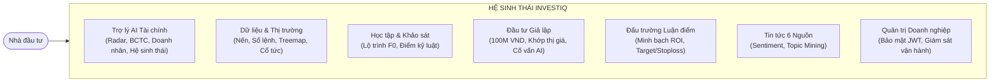
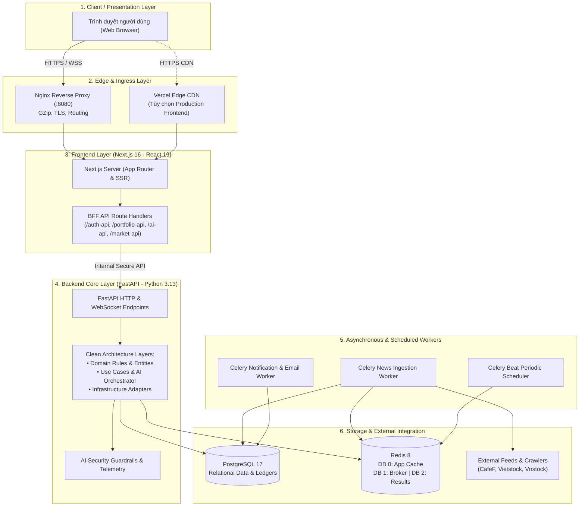

# InvestIQ — Nền tảng Phân tích Định lượng, Trợ lý AI & Giáo dục Chứng khoán Toàn diện

<p align="center">
  
  
  
  
  
  
  
  
  
</p>

---

## 1. Giới Thiệu (Overview)

**InvestIQ** là nền tảng công nghệ tài chính (FinTech) thế hệ mới dành cho thị trường chứng khoán Việt Nam, kết hợp sức mạnh của **Mô hình Định lượng Đa nhân tố (Multi-Factor Quantitative Engine)**, **Trợ lý Trí tuệ Nhân tạo Tài chính Chuyên sâu (Financial AI Assistant)**, cùng hệ sinh thái **Giáo dục & Đầu tư Thực nghiệm (EdTech & Paper Trading)**.

### Vấn đề InvestIQ giải quyết:
- **Nhiễu loạn thông tin & Cảm xúc cá nhân**: Đa số nhà đầu tư cá nhân (đặc biệt là F0) thường đưa ra quyết định dựa trên tin đồn "phím hàng", mạng xã hội hoặc cảm xúc FOMO, thiếu hụt các công cụ phân tích khách quan và độc lập.
- **Rủi ro cháy tài khoản do thiếu kỷ luật**: Thiếu sự chuẩn bị về tâm lý, không biết cách quản lý danh mục và không tuân thủ nguyên tắc cắt lỗ dẫn đến những tổn thất vốn nghiêm trọng.
- **Ảo giác thông tin từ các LLM thông thường**: Các mô hình AI ngôn ngữ chung (ChatGPT, Claude...) thường xuyên gặp hiện tượng "bịa đặt số liệu" (hallucination), không có dữ liệu giá realtime, không hiểu thấu đáo cấu trúc BCTC Việt Nam, hồ sơ doanh nhân hay các hệ sinh thái doanh nghiệp lớn trên sàn HOSE/HNX.

### Giải pháp từ InvestIQ:
InvestIQ mang lại một giải pháp trọn vẹn: **Dữ liệu chuẩn xác thời gian thực**, **Trợ lý AI định lượng không ảo giác**, **Môi trường đầu tư giả lập rèn luyện kỷ luật**, và **Giáo trình phân cấp thực chiến** trước khi nhà đầu tư bước vào thị trường thật.

---

## 2. Các Tính Năng Cốt Lõi (Core Features)



### 2.1. Trợ Lý AI Tài Chính Định Lượng (`/ai-assistant` & Floating Drawer)
Khác biệt hoàn toàn với các chatbot thông thường, InvestIQ AI Assistant vận hành trên **Deterministic Quantitative RAG Pipeline** ưu tiên 100% dữ liệu tài chính nội bộ đã kiểm chuẩn:
- **Biểu đồ Radar Đa nhân tố (5 Dimensions)**: Tự động chấm điểm (0–100) và trực quan hóa 5 trụ cột: Định giá (Valuation), Sức khỏe tài chính (Financial Health), Tăng trưởng (Growth), Động lượng kỹ thuật (Technical Momentum), và Dòng tiền (Cash Flow).
- **So sánh Đối đầu Đa tài sản**: So sánh đối đầu giữa 2 cổ phiếu hoặc so sánh cổ phiếu với **Vàng miếng SJC** và **Lãi suất Tiết kiệm ngân hàng** với dữ liệu lịch sử đối chiếu trực quan.
- **Chẩn đoán Rủi ro BCTC & Cờ đỏ Kế toán**: Tích hợp chỉ số dự báo phá sản **Altman Z-Score** và 4 thuật toán tự động quét cờ đỏ (áp lực nợ vay, dòng tiền kinh doanh âm, chất lượng khoản phải thu).
- **Nhịp đập Thị trường & Rổ VN30 Sôi nổi**: Phân tích chỉ số VN-Index, VN30, HNX, độ rộng thị trường và bóc tách các cổ phiếu trụ cột hoạt động sôi nổi nhất trong phiên.
- **Hồ sơ Doanh nhân & Lãnh đạo Doanh nghiệp**: Cơ sở dữ liệu 22 doanh nhân hàng đầu Việt Nam (Phạm Nhật Vượng, Trần Đình Long, Nguyễn Thị Phương Thảo, Trương Gia Bình...) cùng các huyền thoại quốc tế (Warren Buffett, Charlie Munger...). Cung cấp thị giá cổ phiếu live, tỷ lệ sở hữu, tài sản niêm yết và tổng tài sản Forbes.
- **Bản đồ Hệ sinh thái Doanh nghiệp**: Trực quan hóa cấu trúc tập đoàn, công ty mẹ, công ty con niêm yết, công ty ngoài sàn (như Taxi Xanh GSM, Vinmec) và chuỗi giá trị của 6 đại tập đoàn: Vingroup, Hòa Phát, FPT, Masan & Techcombank, Sovico, SSI & Pan.
- **Lịch Sự kiện & Cổ tức**: Cập nhật lịch chốt quyền cổ tức tiền mặt/cổ phiếu, phát hành thêm, giao dịch nội bộ kèm trích dẫn nguồn công bố chính thức.
- **An toàn & Tối ưu**: Tích hợp Security Guardrails chống Prompt Injection / rò rỉ dữ liệu mật, Shared Cache Redis TTL thông minh, và hệ thống đo lường độ trễ Telemetry từng bước.

### 2.2. Trung Tâm Thị Trường & Phân Tích Cổ Phiếu (`/market`, `/search`)
- **Bảng Giá VN30-First**: Hiển thị bảng giá chuẩn sàn chứng khoán, 9 cột số liệu căn giữa đồng bộ, lọc nhanh theo rổ VN30, nhóm ngành, biến động giá.
- **Biểu đồ Nến Kỹ thuật Đỉnh cao**: Biểu đồ Candlestick chuẩn tài chính tích hợp đường MA5, MA20, Khối lượng giao dịch (Volume), linh hoạt đổi khung thời gian (Ngày, Tuần, Tháng, Năm), hỗ trợ phóng to/thu nhỏ bằng chuột (Mouse wheel zoom) và rê bàn phím (Keyboard pan).
- **Sổ Lệnh 3 Cấp Độ & Khớp Lệnh Realtime**: Quan sát 3 bước giá mua/bán tốt nhất và dòng băng chuyền khớp lệnh trực tiếp (Intraday Execution Tape).
- **Bản đồ Nhiệt Động lượng (Stock & Sector Treemap)**: Trực quan hóa phân bổ dòng tiền toàn thị trường với thuật toán khuếch đại độ tương phản trọng số (> 6x contrast), giữ nguyên thanh chi tiết khi người dùng tương tác.
- **Lịch Cổ Tức Toàn Diện**: Danh sách sự kiện cổ tức toàn sàn có phân trang chuẩn (`Pagination`), sắp xếp theo mốc thời gian gần nhất và gắn link trực tiếp tới văn bản công bố của doanh nghiệp.
- **Trang Tìm Kiếm Chuyên Biệt (`/search`)**: Tra cứu tức thì mọi mã cổ phiếu, lọc theo chỉ số vốn hóa, P/E, P/B và biến động phiên.

### 2.3. Giáo Dục & Đánh Giá Năng Lực Đầu Tư (`/learn`, `/learn/readiness`)
- **Lộ trình Kiến thức Chứng khoán Căn bản**: Giáo trình chuẩn hóa 3 cấp độ (Cơ bản $\rightarrow$ Trung cấp $\rightarrow$ Nâng cao) kết hợp bài đọc lý thuyết, ví dụ thực tế gắn liền với biểu đồ nến VN-Index thực tế và bài kiểm tra trắc nghiệm chấm điểm có giải thích tức thì.
- **Đánh giá Năng lực & Khảo sát Tâm lý (`/learn/readiness`)**:
  - 10 câu hỏi tình huống thực tế đánh giá tâm lý chịu đựng rủi ro.
  - Phân loại 4 hình mẫu nhà đầu tư: *Tích lũy DCA*, *Giá trị & Tăng trưởng*, *Lướt sóng Ngắn hạn*, hay *Bảo thủ/Chứng chỉ quỹ*.
  - **Điểm Kỷ luật Giao dịch (Discipline Score)**: Hệ thống tự động phân tích hành vi trong tài khoản Paper Trading (tỷ lệ tuân thủ cắt lỗ -7%, mức độ đa dạng hóa danh mục, tỷ lệ đệm tiền mặt an toàn, tần suất giao dịch) để xuất ra Báo cáo Chẩn đoán Mức độ Sẵn sàng (Investor Readiness Report) trước khi đưa tiền thật vào thị trường.
- **Đấu Trường Dự Đoán Nến (`/learn/candlestick-arena`)**: Trò chơi giáo dục thử thách dự đoán xu hướng tiếp theo của cây nến dựa trên các mô hình nến đảo chiều kinh điển.

### 2.4. Đầu Tư Giả Lập & Cố Vấn Danh Mục AI (`/portfolio`)
- **Tài khoản Mô phỏng 100.000.000 ₫**: Khởi đầu an toàn cho mọi nhà đầu tư, thực hiện lệnh mua/bán khớp giá thị trường thực tế với cơ chế khóa dòng (Row-locking) bảo vệ dữ liệu concurrency.
- **Sổ cái Minh bạch**: Tách bạch rõ ràng giữa Giá vốn, Thị giá hiện tại, Lãi/Lỗ chưa thực hiện và Lãi/Lỗ đã chốt lời/cắt lỗ kèm lịch sử giao dịch chi tiết.
- **Cố Vấn AI Danh Mục Tự Động (AI Portfolio Advisor)**: Định kỳ quét danh mục của người dùng, phân tích độ tập trung rủi ro, cảnh báo cổ phiếu giảm sâu và tự động soạn thảo gửi Báo cáo Tối ưu Danh mục qua Email.

### 2.5. Đấu Trường Luận Điểm Đầu Tư (`/community`)
- **Proof-of-Thesis Arena**: Môi trường chia sẻ ý tưởng đầu tư văn minh và minh bạch. Mọi bài viết bắt buộc phải có luận điểm phân tích, giá mục tiêu (Target Price), ngưỡng cắt lỗ (Stoploss) và kỳ hạn đầu tư.
- **Xếp hạng Hiệu quả**: Hệ thống tự động theo dõi biến động thị giá để tính toán tỷ suất sinh lời thực tế (Outcome ROI) và xếp hạng uy tín của người viết luận điểm.

### 2.6. Hệ Thống Thu Thập Tin Tức Tự Động 6 Nguồn (`/news`)
- **Thu thập Đa nguồn Thời gian thực**: Tự động tổng hợp tin tức từ 6 đầu báo tài chính uy tín: *Vietstock*, *CafeF*, *HNX*, *StockBiz*, *VnEconomy*, *VnExpress*.
- **Phân tích Cảm xúc & Gắn thẻ Mã**: Tự động phân tích sắc thái bài viết (Tích cực / Tiêu cực / Trung tính), xác định mức độ ảnh hưởng tới thị trường và liên kết chính xác với mã cổ phiếu liên quan.

### 2.7. Cổng Quản Trị Doanh Nghiệp Toàn Diện (`/admin`)
- **Bảo mật Đa tầng**: Bảo vệ nghiêm ngặt bằng JWT role-based (`require_admin_user`) và session độc lập.
- **Bộ Công cụ Vận hành Tập trung**:
  - *Quản lý Tài khoản (`/admin/users`)*: Tìm kiếm, phân quyền, khóa/mở tài khoản, thu hồi phiên làm việc tức thì.
  - *Kiểm duyệt Luận điểm (`/admin/theses`)*: Phê duyệt bài viết cộng đồng và theo dõi trạng thái luận điểm.
  - *Khóa học & Kiến thức (`/admin/learning`)*: CRUD toàn diện giáo trình, ví dụ thực tế và bộ câu hỏi trắc nghiệm.
  - *Quản lý Khảo sát Năng lực (`/admin/assessment`)*: Quản lý ngân hàng câu hỏi tâm lý và cấu hình trọng số các hình mẫu nhà đầu tư.
  - *Giám sát Danh mục (`/admin/portfolios`)*: Tra cứu và kiểm tra hành vi đầu tư mô phỏng của người dùng.
  - *Điều hành Thu thập Dữ liệu (`/admin/data-pipeline`)*: Bật/tắt crawler, theo dõi trạng thái pipeline và dọn dẹp dữ liệu lưu trữ.
  - *Nhật ký Kiểm toán (`/admin/audit-logs`)*: Lưu vết mọi thao tác quản trị nhằm đảm bảo an ninh hệ thống.

---

## 3. Kiến Trúc Kỹ Thuật (Architecture & Tech Stack)

Hệ thống được thiết kế theo mô hình **Monorepo** chuẩn mực, kết hợp **Clean Architecture** ở phía Backend và kiến trúc **Backend-for-Frontend (BFF)** hiện đại ở phía Frontend:



### Chi tiết Công nghệ (Tech Stack Breakdown):
- **Frontend**: Next.js 16 (App Router, Server Components, Server Actions), React 19, TypeScript, Tailwind CSS v4, Lucide Icons, Vitest.
- **Backend**: Python 3.13, FastAPI (Uvicorn), Pydantic v2, Clean Architecture, Pytest, Ruff (Linter & Formatter), Mypy (Static Typing).
- **Cơ sở dữ liệu & Caching**: PostgreSQL 17 (kết nối qua `psycopg` pool có SSL), Redis 8 (chia 3 logical databases độc lập).
- **Xử lý nền & Lập lịch**: Celery 5.6, Celery Beat scheduler cho các tác vụ crawl tin tức và kiểm tra định kỳ.
- **Giám sát & Logs**: Dozzle log viewer, per-step AI telemetry metrics endpoint (`/api/v1/ai/metrics`).

---

## 4. Cấu Trúc Thư Mục (Repository Structure)

```text
investiq/
├── backend/                       # Python 3.13 / FastAPI Application
│   ├── app/
│   │   ├── api/v1/                # REST & WebSocket API Routers (Market, AI, Auth, Admin...)
│   │   ├── application/           # Use Cases, Ports & AI Financial Logic
│   │   │   └── use_cases/ai_chat/ # AI Modular Engine (Intent, Snapshot, RAG, Response...)
│   │   ├── domain/                # Domain Entities & Business Rules
│   │   ├── infrastructure/        # PostgreSQL Repositories, Redis Cache, Crawlers, Settings
│   │   └── workers/               # Celery Tasks (News Ingestion, Email Reminders)
│   ├── tests/                     # Unit Tests, API Integration Tests & Coverage Configuration
│   ├── Dockerfile                 # Backend Container Specification
│   └── requirements.txt           # Python Dependency Pins
├── frontend/                      # Next.js 16 / TypeScript Application
│   ├── src/
│   │   ├── app/                   # App Router Pages & BFF Route Handlers
│   │   ├── components/            # Reusable UI Components (Market, AI, Learn, Admin...)
│   │   ├── lib/                   # API Client, Route Resolvers, Utils
│   │   └── types/                 # TypeScript Domain Type Definitions
│   ├── Dockerfile                 # Frontend Container Specification
│   └── package.json               # NPM Packages & Build Scripts
├── infra/                         # Reverse Proxy (Nginx) & Log Viewer Profiles
├── docs/                          # Detailed Technical Documentation
│   ├── deploy.md                  # Hướng dẫn Triển khai Cloud (Render, Neon, Vercel) & CI/CD
│   ├── deploy-vercel-koyeb.md     # Hướng dẫn Triển khai Phương án 1 (Vercel + Koyeb + Neon) 100% Free Always-On
│   └── plan/                      # Tài liệu Đặc tả Yêu cầu & Kiến trúc Chi tiết
├── scripts/                       # Automation Scripts & Quality Gate
│   └── check-pr.ps1               # Pre-PR / Pre-Push Local CI Quality Gate
├── docker-compose.yml             # Full-Stack 10-Service Topology
└── README.md                      # Project Entry Point
```

---

## 5. Hướng Dẫn Cài Đặt & Chạy Cục Bộ (Quickstart Guide)

### 5.1. Yêu Cầu Môi Trường (Prerequisites)
- **Docker & Docker Compose** (khuyên dùng để chạy đầy đủ mọi dịch vụ).
- Hoặc cài đặt cục bộ: **Node.js 22+**, **Python 3.13+**, **PostgreSQL 16+**, **Redis 7+**.

### 5.2. Cách 1: Chạy bằng Docker Compose (Khuyên dùng - 1 câu lệnh)
1. **Clone repository**:
   ```bash
   git clone https://github.com/Trannguyen08/investiq.git
   cd investiq
   ```
2. **Khởi tạo biến môi trường**:
   ```bash
   cp .env.example .env
   ```
   *(Mặc định cấu hình đã được tối ưu sẵn cho môi trường Local Development).*
3. **Khởi động toàn bộ 10 dịch vụ**:
   ```bash
   docker compose up --build -d
   ```
4. **Áp dụng Database Migrations**:
   ```bash
   docker compose run --rm backend python -m app.infrastructure.db.base
   ```
5. **Truy cập ứng dụng**:
   - **Frontend UI**: [http://localhost:3000](http://localhost:3000) (hoặc qua Nginx: [http://localhost:8080](http://localhost:8080))
   - **Backend API Docs (Swagger)**: [http://localhost:8080/docs](http://localhost:8080/docs) (hoặc [http://localhost:8000/docs](http://localhost:8000/docs))
   - **Dozzle Log Viewer**: [http://localhost:9999](http://localhost:9999)

---

### 5.3. Cách 2: Chạy trực tiếp trên máy không dùng Docker (Bare-metal)

#### Khởi chạy Backend:
```bash
cd backend
python -m venv .venv
# Trên Windows: .\.venv\Scripts\activate | Trên Linux/macOS: source .venv/bin/activate
pip install -r requirements-dev.txt
python -m app.infrastructure.db.base
uvicorn app.main:app --host 0.0.0.0 --port 8000 --reload
```

#### Khởi chạy Frontend:
```bash
cd frontend
npm install
npm run dev
# Mở trình duyệt tại http://localhost:3000
```

---

## 6. Kiểm Thử & Tiêu Chuẩn Chất Lượng (Quality Gate)

Hệ thống được bảo vệ bởi **Pre-PR / Pre-Push Quality Gate** tự động (`./scripts/check-pr.ps1`), mô phỏng 100% quy trình kiểm tra của GitHub Actions CI:

```powershell
# Chạy toàn bộ 6 bước kiểm tra chất lượng trước khi tạo PR hoặc Push:
.\scripts\check-pr.ps1
```

```text
====================================================
   INVESTIQ LOCAL CI / PRE-PR QUALITY GATE
====================================================
[1/6] Kiểm tra Git Diff Whitespace (git diff origin/dev --check)...  -> PASSED
[2/6] Kiểm tra Frontend Lint (ESLint)...                             -> PASSED
[3/6] Kiểm tra Frontend TypeScript Typecheck (tsc)...                -> PASSED
[4/6] Kiểm tra Frontend Unit Tests (Vitest 186/186 passed)...        -> PASSED
[5/6] Kiểm tra Backend Ruff & Mypy (0 errors / 43 files)...          -> PASSED
[6/6] Kiểm tra Backend Unit Tests (Pytest 169/169 passed)...         -> PASSED
====================================================
KẾT QUẢ: TẤT CẢ KIỂM TRA ĐỀU XANH (READY FOR PR / MERGE)!
```

### Chạy kiểm thử riêng lẻ:
- **Backend Tests**: `cd backend && pytest`
- **Backend Linting**: `cd backend && ruff check . && mypy`
- **Frontend Tests**: `cd frontend && npm test`
- **Frontend Typecheck**: `cd frontend && npm run typecheck`

---

## 7. Triển Khai Môi Trường Thực Tế (Cloud Deployment)

InvestIQ hỗ trợ các mô hình triển khai đám mây tối ưu chi phí và hiệu năng:

### Phương án 1 (Khuyên dùng): Frontend Vercel + Backend Koyeb + Neon.tech DB (100% Free & Always-On 24/7)
- **Frontend (Vercel)**: Tận dụng Edge Network toàn cầu của Vercel cho Next.js, loại bỏ 100% hiện tượng cold-start, tốc độ tải trang tức thì (< 50ms).
- **Backend (Koyeb)**: Chạy Web Service FastAPI (gói Free Eco Always-On 24/7, không bao giờ ngủ đông/spin-down, không cần ping keep-alive).
- **Database (Neon.tech)**: PostgreSQL Serverless máy chủ Singapore `aws-ap-southeast-1` cho độ trễ cực thấp 5–15ms, miễn phí vĩnh viễn kèm connection pooling.

> [!TIP]
> Xem hướng dẫn cấu hình chi tiết từng bước cho Phương án 1 tại tài liệu: [`docs/deploy-vercel-koyeb.md`](docs/deploy-vercel-koyeb.md), và hướng dẫn triển khai Render tại [`docs/deploy.md`](docs/deploy.md).

---

## 8. An Toàn & Bảo Mật (Security & Compliance)

- **Nguyên tắc Không lưu Mật khẩu & Token**: Tuyệt đối không commit file `.env` lên GitHub; toàn bộ khóa bí mật được quản lý thông qua GitHub Actions Secrets và Cloud Environment Variables.
- **Fail-Closed Design**: Mọi chức năng yêu cầu quyền (Admin, Paper Trading, Auth) đều mặc định từ chối truy cập (Fail-closed) nếu thiếu biến môi trường hoặc token không hợp lệ.
- **BFF Security Layer**: Token xác thực JWT và session nhạy cảm được mã hóa lưu trữ ở Redis phía máy chủ Next.js BFF; trình duyệt người dùng chỉ nhận cookie `HttpOnly`, `SameSite=Lax`, ngăn chặn hoàn toàn tấn công XSS đánh cắp token.
- **Bảo vệ Trợ lý AI**: Bộ lọc `Guardrails` quét toàn bộ input/output, ngăn chặn triệt để kỹ thuật tấn công chèn lệnh (Prompt Injection), lệnh phá hoại cơ sở dữ liệu (`DROP`, `DELETE`), và cấm tuyệt đối việc làm lộ biến môi trường hệ thống.

---

## 9. Giấy Phép & Bản Quyền (License & Disclaimer)

- **Mục đích**: Nền tảng được phát triển phục vụ mục đích nghiên cứu, học tập và hỗ trợ phân tích đầu tư định lượng.
- **Tuyên bố Miễn trừ Trách nhiệm Tài chính (Disclaimer)**: Mọi thông tin, điểm số định lượng, phân tích kỹ thuật và phản hồi từ Trợ lý AI chỉ mang tính chất tham khảo giáo dục, không cấu thành lời mời chào hay khuyến nghị mua/bán bất kỳ chứng khoán nào. Nhà đầu tư tự chịu trách nhiệm hoàn toàn đối với các quyết định giao dịch bằng tiền thật trên thị trường chứng khoán.

---

<p align="center">
  <b>InvestIQ</b> — Nâng tầm tri thức và kỷ luật cho nhà đầu tư Việt Nam.<br/>
  <i>Được phát triển với niềm đam mê dành cho Công nghệ Tài chính & Trí tuệ Nhân tạo.</i>
</p>
