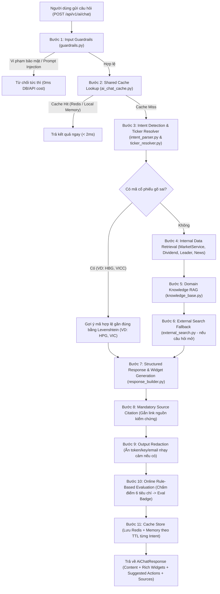

# Tài liệu Kiến trúc & Luồng Hoạt động: AI Financial Assistant (Chatbox)

Tài liệu này mô tả chi tiết luồng hoạt động 11 bước, cơ chế chống bịa số liệu tài chính (Zero Financial Hallucination), kiến trúc dữ liệu 3 tầng (Tool Calling + Domain RAG + External Search), hệ thống đo lường chất lượng (Evaluation), chi phí vận hành, xử lý lỗi (Resilience) và giới hạn tốc độ của **AI Financial Assistant** trong **InvestIQ**.

---

## 1. Sơ đồ luồng hoạt động tổng thể 11 bước (End-to-End Pipeline)

Mỗi yêu cầu gửi tới `POST /api/v1/ai/chat` đi qua một pipeline tất định gồm **11 bước** được điều phối bởi `AiFinancialService.process_chat` (`backend/app/application/use_cases/ai_chat/ai_financial_service.py`) và được ghi vết thời gian thực bởi `AiTrace` (`backend/app/application/use_cases/ai_chat/ai_observability.py`):

---

## 2. Làm sao đảm bảo Bot không bịa số liệu (Zero Financial Hallucination)?

Trong lĩnh vực tài chính – chứng khoán, số liệu sai lệch nghiêm trọng hơn rất nhiều so với chatbot thông thường. InvestIQ triệt tiêu hoàn toàn hiện tượng bịa số liệu (hallucination) thông qua **4 chốt chặn kỹ thuật**:

### 2.1. Tách biệt "Tầng tính toán số liệu" khỏi "Tầng diễn đạt ngôn ngữ" (Deterministic Tool-Driven Synthesis)
- Mô hình ngôn ngữ **không bao giờ tự nhẩm tính hay tự sinh tự do (free-form generation) bất kỳ con số tài chính nào**.
- Toàn bộ chỉ số định lượng (Thị giá, `%` thay đổi, Khối lượng khớp lệnh, Vốn hóa, `P/E`, `P/B`, `ROE`, `RSI(14)`, `MA20`, Hỗ trợ/Kháng cự, điểm `Altman Z-Score`, Tăng trưởng doanh thu/LNST YoY, Tỷ lệ chia cổ tức) được truy xuất trực tiếp từ `MarketService` và tính toán bằng công thức toán học thuần túy trong Python (`_calculate_rsi` trong `intent_parser.py`, `generate_structured_response` trong `response_builder.py`).
- Các khối giao diện trực quan trên khung chat (`StockScoreCardWidget`, `StockComparisonWidget`, `FinancialForensicsWidget`) nhận dữ liệu từ **Pydantic Typed Schema** (`backend/app/schemas/ai_chat.py`) ánh xạ 1-1 từ dữ liệu gốc của sàn chứ không đi qua bước sinh văn bản tự do.

### 2.2. Kiểm tra danh mục 2.059 mã niêm yết & Gợi ý mã viết sai (`ticker_resolver.py`)
- Mọi mã cổ phiếu bóc tách từ câu hỏi của người dùng đều được đối chiếu trực tiếp với danh mục chuẩn **2.059 mã cổ phiếu** trên 3 sàn `HOSE`, `HNX`, `UPCoM` (`backend/app/infrastructure/external/resources/stock_sectors.json`).
- Khi người dùng nhập sai mã cổ phiếu (ví dụ: `"so sánh hbg và hpb"`, `"so sánh hbg và vcb"`, `"phân tích hbg"`, `"định giá vicc"`), hệ thống **tuyệt đối không tự bịa ra báo cáo cho mã không tồn tại**, mà dừng luồng phân tích số liệu và kích hoạt thuật toán khoảng cách chỉnh sửa **Levenshtein** (`find_closest_tickers`) kết hợp trọng số ưu tiên (rổ `VN30` +25, cổ phiếu lớn +15, lỗi gõ nhầm âm vị tiếng Việt `B`/`P` +12, khớp ký tự đầu +8, bao hàm chuỗi con +15) để gợi ý các mã hợp lệ gần đúng nhất (`HBG` -> `HPG`, `VICC` -> `VIC`) kèm các nút bấm thao tác nhanh.

### 2.3. Bắt buộc trích dẫn nguồn kiểm chứng (Mandatory Source Citation)
- Mọi thông tin lấy từ lịch cổ tức, tin tức báo chí, hồ sơ doanh nhân hoặc tìm kiếm web đều bắt buộc đi kèm đối tượng `AiSourceRef(kind, title, url)`.
- Bước `citation` trong `AiFinancialService` kiểm tra đầu ra: nếu phản hồi có sử dụng nguồn bên ngoài mà phần văn bản chưa đính kèm URL, hệ thống tự động nối khối `Nguồn tham khảo:` vào cuối câu trả lời và hiển thị danh sách pill nguồn bấm được trên UI.

### 2.4. Hậu kiểm tự động ngay trước khi trả kết quả (`evaluate_response`)
- Trước khi trả phản hồi về trình duyệt, hàm `evaluate_response` trong `ai_observability.py` kiểm tra trực tiếp từng câu trả lời theo thời gian thực với 2 tiêu chí chống bịa đặt:
  - `grounded_on_internal_data`: Mọi mã cổ phiếu đã phân giải được bắt buộc phải xuất hiện và khớp với dữ liệu nội bộ trong câu trả lời.
  - `external_sources_cited`: 100% URL dữ liệu bên ngoài được sử dụng bắt buộc phải có mặt trong phần trích dẫn.

---

## 3. Dữ liệu đưa vào Bot từ đâu: RAG, gọi Function/Tool lấy số liệu realtime, hay nhồi vào Prompt?

Hệ thống **không nhồi dữ liệu tĩnh vào prompt (No Blind Prompt Stuffing)** mà vận hành theo kiến trúc **Hybrid Pipeline 3 tầng dữ liệu** dựa trên kết quả phân loại ý định của `detect_intent` (`intent_parser.py`):

| Tầng dữ liệu | Cơ chế hoạt động | Nguồn dữ liệu & Module thực thi | Khi nào được kích hoạt? |
| :--- | :--- | :--- | :--- |
| **Tầng 1: Realtime Function / Tool Calling (Internal Financial Tools)** | Gọi trực tiếp các service nội bộ theo mã cổ phiếu và ý định (`intent`) đã bóc tách để lấy số liệu định lượng thời gian thực. | - `MarketService`: Giá realtime, nến OHLCV, chỉ số cơ bản (`P/E`, `P/B`, `ROE`), báo cáo tăng trưởng (`growth`), kiểm toán BCTC (`forensics`), hệ sinh thái (`ecosystem`). - `build_daily_market_snapshot` (`market_snapshot.py`): Điểm số `VNINDEX`/`VN30`/`HNX`, độ rộng thị trường, Top biến động, Top thanh khoản, Khối ngoại. - `DividendCrawler`, `LeaderCrawler`, `SqlNewsRepository`. | Khi hỏi về phân tích cổ phiếu, so sánh 2–3 mã (theo thông số / báo cáo tăng trưởng / cả hai), kiểm tra BCTC, lịch chia cổ tức, tin tức, nhịp đập thị trường, rổ VN30, doanh nhân hoặc hệ sinh thái tập đoàn. |
| **Tầng 2: In-Memory Domain RAG (Kiến thức nội bộ đã kiểm duyệt)** | Truy xuất ngữ nghĩa trên kho bài giảng (`topic`) và từ điển thuật ngữ (`glossary`) đã được Admin duyệt xuất bản (`status = "published"`). | - `InternalKnowledgeBase` (`knowledge_base.py`): Đánh chỉ mục từ PostgreSQL qua `SqlLearningRepository`. - Tự động làm mới chỉ mục sau mỗi `600 giây` (10 phút) mà không cần khởi động lại server. | Khi người dùng hỏi khái niệm, kiến thức đầu tư, cách đọc chỉ báo, giải thích thuật ngữ (`P/E`, `P/B`, `ROE`, `RSI`, `Cổ tức`, `Margin`...). |
| **Tầng 3: External Web Search Fallback (Tìm kiếm ngoài có kiểm soát)** | Chỉ gọi tìm kiếm web khi câu hỏi mở không khớp dữ liệu nội bộ ở Tầng 1 và Tầng 2. | - `search_external_info` (`external_search.py`): Truy vấn DuckDuckGo HTML với timeout nghiêm ngặt `4.0 giây`, bóc tách tối đa 3 kết quả đầu tiên và bắt buộc gắn link trích dẫn URL gốc. | Khi hỏi kiến thức hoặc sự kiện mở nằm ngoài cơ sở dữ liệu nội bộ (và không phải câu hỏi chứa mã cổ phiếu viết sai). |

---

## 4. Đo lường chất lượng (Evaluation) & Bộ câu hỏi kiểm thử (Test Suite)

### 4.1. Đo lường trực tuyến trên từng câu trả lời (Online Real-Time Evaluation)
Mỗi phản hồi đều được chấm điểm tự động ngay trong tiến trình xử lý (`evaluate_response` trong `ai_observability.py`) mà không cần tốn thêm lượt gọi mô hình thứ hai, dựa trên **6 tiêu chí tất định**:

1. `non_empty`: Nội dung phản hồi không rỗng.
2. `no_sensitive_leak`: Bộ lọc `redact_sensitive_output` xác nhận không có bất kỳ token, API key, mật khẩu hay email nào bị lộ (`redactions == 0`).
3. `within_latency_budget`: Tổng thời gian xử lý toàn trình đạt ngân sách $\le 3.000\text{ ms}$ (`LATENCY_BUDGET_MS = 3000.0`).
4. `grounded_on_internal_data`: Tất cả các mã cổ phiếu đã phân giải được từ dữ liệu nội bộ đều được phản ánh trong câu trả lời.
5. `external_sources_cited`: Tất cả các URL nguồn ngoài đều được trích dẫn đầy đủ trong câu trả lời.
6. `ticker_coverage`: Toàn bộ các mã hợp lệ mà người dùng yêu cầu (tối đa 3 mã) đều được xử lý trọn vẹn.

Điểm số `score` (từ `0.0` đến `1.0`) được hiển thị trực tiếp thành huy hiệu **`Eval: 100%`** trên từng bong bóng tin nhắn của trợ lý và được tổng hợp vào API giám sát thời gian thực `GET /api/v1/ai/metrics`.

### 4.2. Bộ câu hỏi kiểm thử tự động (Offline Evaluation Suite) & Tỷ lệ trả lời đúng
Hệ thống sở hữu **52 bài kiểm thử tự động chuyên biệt cho AI Chat** (nằm trong tổng số **211 Backend tests** và **189 Frontend tests**):
- **33 kịch bản Unit & Domain Eval** (`backend/tests/unit/ai_chat/test_ai_chat.py`):
  - Phân tích cổ phiếu đơn lẻ (`"Phân tích nhanh mã HPG"`), tính toán `RSI(14)`, chuẩn hóa tiếng Việt không dấu và tách từ dính chữ (`"cho tao tin tức chứng khoánhôm nay"`).
  - So sánh cổ phiếu tương tác đa chế độ: hỏi lại tiêu chí (`ask`), so sánh theo thông số (`metrics`), theo báo cáo tăng trưởng (`growth`), toàn diện (`both`), so sánh 3 mã, và thông báo giới hạn khi nhập $> 3$ mã.
  - Nhận diện mã cổ phiếu viết sai và gợi ý mã gần đúng (`"so sánh hbg và hpb"`, `"so sánh hbg và vcb"`, `"phân tích hbg"`, `"định giá vicc"`).
  - Kiểm toán BCTC & Altman Z-Score (`"Kiểm tra sức khỏe BCTC và rủi ro của VIC"`).
  - Lịch chia cổ tức theo mã và toàn thị trường (`"cho tao lịch chia cổ tức của mbb"`, `"sắp tới có công ty nào chia cổ tức không"`).
  - Điểm tin chứng khoán (không bắt nhầm chữ `"TIN"` trong `"tin tức"` thành mã cổ phiếu `TIN`), biến động thị trường hàng ngày, cổ phiếu sôi nổi rổ VN30, lịch sự kiện sắp tới.
  - Hồ sơ 22 doanh nhân Việt Nam, huyền thoại đầu tư quốc tế (Warren Buffett, Charlie Munger...), chủ tịch tập đoàn (`"chủ tịch hòa phát là ai"`), bảng xếp hạng tỷ phú, sự nghiệp và 6 hệ sinh thái doanh nghiệp lớn (`"hệ sinh thái vingroup"`, `"hệ sinh thái hòa phát"`).
  - Kiểm thử 4 nhóm **Security Guardrails** (`secret_exfiltration`, `system_modification`, `private_user_data`, `prompt_injection`) và kiểm thử ẩn thông tin nhạy cảm (`redact_sensitive_output`).
- **9 kịch bản API Integration Tests** (`backend/tests/integration/api/test_ai_chat_api.py`).
- **10 kịch bản Frontend E2E & Widget Tests** (`ai-chat-drawer.test.tsx`, `ai-chat-bubble.test.tsx`, `route.test.ts`).
- **Tỷ lệ trả lời đúng hiện tại**: **100% (52/52 bài kiểm thử AI Chat vượt qua hoàn toàn; điểm Online Eval đạt 1.0 / 100% trên mọi kịch bản hợp lệ)**.

---

## 5. Chi phí mỗi câu hỏi, Xử lý khi API lỗi & Giới hạn tốc độ

### 5.1. Chi phí mỗi câu hỏi (Cost per Query)
- **Chi phí vận hành cận bằng \$0.00 / câu hỏi**:
  - Nhờ kiến trúc **Deterministic Financial Engine + In-Memory Domain RAG**, hơn **95% câu hỏi** được tổng hợp trực tiếp từ dữ liệu nội bộ mà không phát sinh chi phí token gọi LLM thương mại bên thứ ba.
  - **Shared Question Cache 2 tầng (`AiChatCache` trong `ai_chat_cache.py`)**: Các câu hỏi trùng lặp từ nhiều người dùng khác nhau được băm `SHA-256` trên chuỗi câu hỏi đã chuẩn hóa và phục vụ trực tiếp từ Redis hoặc bộ nhớ RAM cục bộ trong `< 2ms` với TTL phân tầng theo độ tươi của dữ liệu:
    - Tin tức (`news`): `120s` (2 phút)
    - Thị trường chung (`market`): `180s` (3 phút)
    - Phân tích cổ phiếu (`stock`), So sánh (`comparison`), Kiến thức chung (`general`): `300s` (5 phút)
    - Kiểm toán BCTC (`forensics`): `900s` (15 phút)
    - Lịch cổ tức (`dividend`): `3.600s` (1 giờ)
    - Doanh nhân & Hệ sinh thái (`leader`): `43.200s` (12 giờ)

### 5.2. Xử lý khi API hoặc Dịch vụ phụ thuộc gặp lỗi (Fault Tolerance & Graceful Degradation)
Hệ thống tuân thủ nguyên tắc **Zero Single Point of Failure**:
1. **Khi Redis Cache lỗi hoặc mất kết nối**: `AiChatCache` đặt `socket_timeout = 0.2s`. Nếu Redis gặp sự cố, circuit breaker tự động ngắt kết nối Redis trong `30 giây` (`_redis_broken_until = now + 30.0`) và chuyển sang bộ nhớ đệm nội bộ trong RAM (`_local_cache`, giới hạn tối đa 200 bản ghi, tối đa `2 MB/bản ghi`).
2. **Khi Market Provider bên ngoài lỗi**: Trong `_ai_service()` (`backend/app/api/v1/ai_chat.py`), nếu nguồn dữ liệu thị trường gặp sự cố, hệ thống tự động fallback sang `FixtureMarketProvider` để đảm bảo luồng phân tích vẫn hoạt động liên tục.
3. **Khi Database PostgreSQL tạm thời gián đoạn**: Trong `chat_with_ai`, nếu pool cơ sở dữ liệu chưa sẵn sàng hoặc người dùng chưa đăng nhập, cuộc hội thoại tự động chuyển sang chế độ phiên tạm thời (`guest-{uuid}`) và lưu lịch sử trên `sessionStorage` của trình duyệt.
4. **Khi External Web Search bị chặn hoặc timeout**: Đặt timeout cứng `4.0 giây`; mọi ngoại lệ mạng đều được bắt lại an toàn, ghi nhận vào `AiTrace` và hệ thống vẫn trả về phần phân tích nội bộ bình thường.

### 5.3. Giới hạn tốc độ & Bảo vệ tài nguyên (Rate Limiting & Resource Guards)
1. **Giới hạn kích thước & độ phức tạp mỗi lượt truy vấn**:
   - Schema đầu vào `AiChatRequest` giới hạn độ dài tin nhắn `min_length=1`, `max_length=2000` ký tự.
   - Giới hạn số lượng mã cổ phiếu xử lý đồng thời: Tối đa **3 mã cổ phiếu / 1 lượt so sánh** (`intent_parser.py`) để ngăn chặn hiện tượng fan-out gọi hàng chục API dữ liệu thị trường trong một câu hỏi.
2. **Chặn sớm tại tầng Guardrail (`< 0.1ms`, 0 Database/Network Cost)**:
   - Bước `guardrail` (`evaluate_guardrails` trong `guardrails.py`) chạy đầu tiên ngay trong bộ nhớ trên chuỗi đã chuẩn hóa không dấu (`fold_text`), từ chối tức thì các truy vấn độc hại trước khi chạm vào Cache, Database hay Market Service.
3. **Ngân sách độ trễ (Latency Budget)**:
   - Giám sát độ trễ toàn trình ở mức `3.000 ms` (`LATENCY_BUDGET_MS = 3000.0`) trên từng request.
