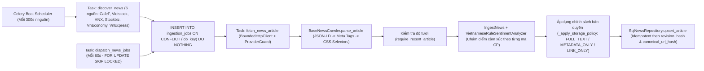
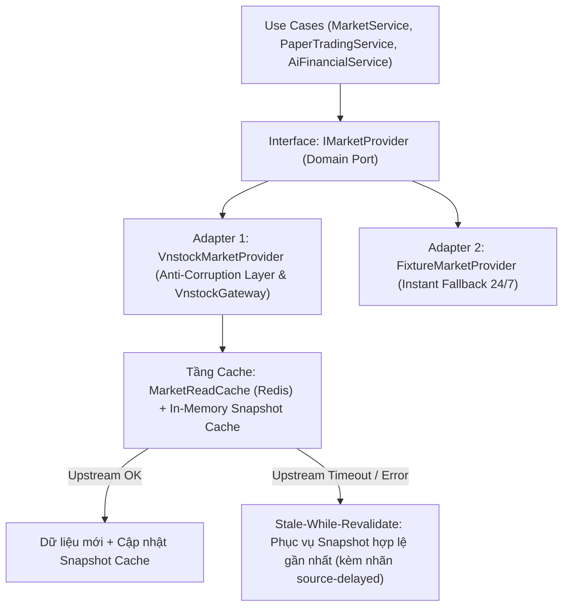

# Tài liệu Kiến trúc & Độ tin cậy: Data Pipeline (News Crawler & Market Data Engine)

Tài liệu này mô tả chi tiết luồng thu thập và xử lý dữ liệu của **InvestIQ Data Pipeline**, giải đáp toàn diện các câu hỏi kỹ thuật về: lịch chạy định kỳ, xử lý khi trang báo đổi cấu trúc HTML, cơ chế Retry / Deduplication / Theo dõi lỗi, tính Idempotent 100% của tác vụ Celery, giải pháp phòng vệ rủi ro khi sử dụng thư viện bên thứ ba `vnstock`, và chính sách tuân thủ pháp lý / bản quyền báo chí.

---

## 1. Sơ đồ luồng thu thập & xử lý tin tức 6 nguồn (Celery & PostgreSQL)

Hệ thống thu thập tin tức tự động từ **6 nguồn báo tài chính & sở giao dịch chính thức** (`CafeF`, `Vietstock`, `HNX`, `Stockbiz`, `VnEconomy`, `VnExpress`) thông qua kiến trúc **2 pha (Discovery -> Persisted Job Dispatch)**:

---

## 2. Crawl CafeF, Vietstock: Chạy định kỳ, Đổi HTML, Retry, Dedup & Tính Idempotent

### 2.1. Chạy định kỳ như thế nào?
Trong `backend/app/workers/celery_app.py`, bộ lập lịch **Celery Beat** điều phối các tác vụ trên hàng đợi chuyên biệt `news-ingestion`:
1. **Khởi tạo tức thì khi bật hệ thống (`discover_news_on_beat_start`)**:
   - Ngay khi tiến trình Celery Beat khởi động, signal `beat_init` tự động kích hoạt lượt quét khởi tạo cho cả 6 nguồn báo sau `5 giây`.
2. **Pha 1 — Quét RSS/Sitemap định kỳ (`investiq.news.discover.v1`)**:
   - Chạy định kỳ mỗi **300 giây (5 phút/lần)** cho từng nguồn (`vietstock`, `cafef`, `hnx`, `stockbiz`, `vneconomy`, `vnexpress`), mỗi lần lấy tối đa 50 URL mới nhất trong khung thời gian hợp lệ (`news_ingestion_max_age_hours`).
3. **Pha 2 — Điều phối thực thi bền vững (`investiq.news.dispatch.v1`)**:
   - Chạy mỗi **60 giây (1 phút/lần)** trong `dispatch_news_jobs` (`backend/app/workers/news_ingestion_worker.py`) để lấy các job đang ở trạng thái `pending` (hoặc các job bị treo quá hạn thuê bao `lease_until` 2 phút do worker tắt đột ngột) bằng truy vấn `FOR UPDATE SKIP LOCKED` và đẩy vào worker thực thi.
4. **Pha 3 — Phục hồi quét lịch sử (`investiq.news.resume-backfills.v1`)**:
   - Chạy mỗi **300 giây** để tự động nối lại các tiến trình backfill lịch sử bị gián đoạn dựa trên checkpoint trong bảng `news_backfill_progress`.

---

### 2.2. Khi trang báo đổi cấu trúc HTML/CSS thì sao?
Trong `BaseNewsCrawler.parse_article` (`backend/app/infrastructure/external/crawlers/base.py`), hệ thống **không phụ thuộc vào một CSS selector cứng duy nhất** mà thiết kế cơ chế **Fallback 3 tầng bóc tách** kết hợp **Cờ cảnh báo chất lượng tự động (`quality_flags`)**:

1. **Tầng 1 — Chuẩn dữ liệu có cấu trúc JSON-LD (`<script type="application/ld+json">`)**:
   - Hàm `_json_ld_articles` ưu tiên đọc chuẩn Schema.org (`NewsArticle` / `Article`: `headline`, `description`, `datePublished`, `dateModified`, `author`, `image`, `keywords`). Các báo lớn như CafeF, Vietstock, VnExpress luôn duy trì chuẩn JSON-LD này ổn định cho Google News ngay cả khi họ đổi toàn bộ giao diện HTML/CSS.
2. **Tầng 2 — Thẻ Meta chuẩn OpenGraph & Twitter Card**:
   - Nếu thiếu JSON-LD, hàm `_meta_content` tự động đọc `og:title`, `og:description`, `article:published_time`, `og:image`.
3. **Tầng 3 — Danh sách CSS Selectors đa phương án (`title_selectors`, `description_selectors`, `content_selectors`)**:
   - Mỗi crawler khai báo một tuple gồm nhiều selector dự phòng (ví dụ: `.article-detail-section__main`, `.main-detail-page`, `.detail__content`, `.post-content`).
4. **Hạ cấp an toàn & Cảnh báo Admin khi DOM thay đổi hoàn toàn**:
   - Nếu trang báo đổi hoàn toàn các class của phần thân bài khiến không lấy được nội dung hoặc nội dung ngắn bất thường ($< 500$ ký tự), parser **không bị crash** mà gắn cờ `quality_flags = ("content_missing",)` hoặc `("content_short",)` và chuyển trạng thái `extraction_status` sang `METADATA_ONLY` hoặc `PARTIAL`.
   - Khi lưu xuống cơ sở dữ liệu (`SqlNewsRepository.upsert_article`), các bài viết chưa đạt trạng thái `COMPLETE` sẽ tự động được giữ ở trạng thái `visibility = 'withdrawn'` để không hiển thị bài lỗi ra ngoài trang người dùng, đồng thời xuất hiện trong mục **Extraction Review** trên Admin Console (`/admin`) để kỹ sư cập nhật selector và nâng `parser_version`.

---

### 2.3. Có Retry, Deduplication và Theo dõi lỗi không?

#### A. Retry (Thử lại với Exponential Backoff & Circuit Breaker)
- Trong `process_ingestion_job` và `fetch_news_article` (`backend/app/workers/news_ingestion_worker.py`), khi gặp lỗi mạng hoặc HTTP từ nguồn báo (`NewsProviderError`), hệ thống tự động tăng `attempt_count`, tính thời gian lùi lũy thừa `countdown = min(60, 5 * (2 ** (attempt - 1)))` (`5s` -> `10s` -> `20s` -> `40s` -> `60s`) và cập nhật `next_attempt_at`.
- Khi vượt quá `max_attempts`, job chuyển sang `status = 'failed'` với mã lỗi `error_code = 'ATTEMPTS_EXHAUSTED'`.
- Lớp HTTP `BoundedHttpClient` (`base.py`) tích hợp `ProviderGuard` (`backend/app/infrastructure/external/provider_guard.py`) để giới hạn tốc độ gọi theo từng domain, giới hạn kích thước tải về tối đa `5 MiB`, chống SSRF (`validate_provider_url`) và tự động ngắt mạch (**Circuit Breaker** — `ProviderCircuitOpen`) khi nguồn báo lỗi liên tiếp.

#### B. Deduplication (Khử trùng lặp 3 tầng)
1. **Chuẩn hóa URL (`canonicalize_url`)**: Cắt bỏ toàn bộ các tham số theo dõi quảng cáo (`utm_*`, `fbclid`, `gclid`) và chuẩn hóa chữ thường cho domain/scheme.
2. **Khử trùng theo URL trên từng nguồn**: Bảng `news_articles` đánh khóa duy nhất trên `(source_id, canonical_url_hash)` với mã băm `SHA-256`.
3. **Khử trùng đa nguồn báo (`duplicate_group_key`)**: Hàm `_duplicate_group_key` trong `sql_news_repository.py` chuẩn hóa Unicode `NFC` + chữ thường tiêu đề bài viết để sinh mã băm nhóm trùng lặp, cho phép phát hiện cùng một bản tin được đăng lại trên nhiều tờ báo khác nhau (`duplicate_source_count`).

#### C. Theo dõi lỗi (Observability & Admin Telemetry)
- Mọi đợt quét được ghi vào bảng `crawl_runs` (`discovered_count`, `queued_count`, `status`) và từng bài viết được giám sát chi tiết trong bảng `ingestion_jobs` (`status`, `attempt_count`, `error_code`, `lease_until`).
- Quản trị viên theo dõi trực tiếp tỷ lệ thành công, lỗi theo nguồn và điều khiển bật/tắt nguồn qua giao diện **News Pipeline Dashboard** (`frontend/src/components/admin/news-pipeline-dashboard.tsx`).

---

### 2.4. Task Celery có Idempotent không (Chạy 2 lần có sinh dữ liệu trùng không)?

**Hoàn toàn Idempotent 100%** ở cả 3 giai đoạn nhờ thiết kế khóa giao dịch và mã băm tất định:

| Giai đoạn | Cơ chế đảm bảo Idempotent | Kết quả khi chạy lặp lại 2+ lần |
| :--- | :--- | :--- |
| **1. Tạo Job (`_persist_discovery`)** | Sinh khóa tất định `job_key = SHA256("fetch:{source_slug}:{window}:{canonical_url}")` và dùng lệnh SQL `INSERT INTO ingestion_jobs ... ON CONFLICT (job_key) DO NOTHING`. | Không có bất kỳ job trùng lặp nào được tạo thêm trong bảng `ingestion_jobs`. |
| **2. Thực thi Job (`process_ingestion_job`)** | Khóa dòng bằng `SELECT ... FOR UPDATE`. Nếu `status == 'succeeded'` thì trả về ngay `{"changed": False}`; nếu đang `running` và `lease_until >= now` thì bỏ qua; tăng `fencing_token` mỗi lượt chạy. | Không crawl lại job đã thành công và không xảy ra race condition giữa nhiều worker chạy song song. |
| **3. Lưu bài viết (`SqlNewsRepository.upsert_article`)** | Khóa bài viết theo `(source_id, canonical_url_hash)` và tính `revision_hash = SHA256(revision_payload)`. | Nếu nội dung bài báo không thay đổi (`revision_hash` trùng khớp), hệ thống **không tạo bài mới cũng không sinh thêm revision mới**, chỉ cập nhật `last_seen_at` và trả về `changed = False`. |

---

## 3. Dữ liệu từ `vnstock`: Xử lý rủi ro thư viện bên thứ ba (Cache, Fallback & Cô lập)

Vì `vnstock` là thư viện bên thứ ba lấy dữ liệu từ các nguồn không chính thức (có thể đổi định dạng trả về, bị giới hạn tốc độ hoặc ngừng hoạt động bất cứ lúc nào), InvestIQ kiểm soát rủi ro này bằng **4 lớp phòng thủ** trong `backend/app/infrastructure/external/vnstock_market_provider.py`:

1. **Lớp 1 — Cô lập hoàn toàn qua kiến trúc Ports & Adapters (`IMarketProvider` & `VnstockGateway`)**:
   - Toàn bộ tầng nghiệp vụ (`MarketService`, `PaperTradingService`, `AiFinancialService`) chỉ gọi qua giao diện trừu tượng `IMarketProvider` (`backend/app/domain/repositories/i_market_provider.py`), hoàn toàn không phụ thuộc trực tiếp vào `vnstock`.
   - Bên trong `VnstockMarketProvider`, giao thức `VnstockGateway` và các hàm kiểm tra kiểu dữ liệu (`_frame_records`, `_series_strings`, `_snake_record`) đóng vai trò **Anti-Corruption Layer**: nếu thư viện `vnstock` thay đổi tên cột hoặc kiểu trả về của Pandas DataFrame, lỗi được bắt gọn tại biên adapter thay vì làm sập ứng dụng.
2. **Lớp 2 — Cache đa tầng & Cơ chế Stale-While-Revalidate (Ưu tiên trả dữ liệu Cache khi nguồn chết)**:
   - Hệ thống duy trì cả `MarketReadCache` (Redis + Memory) lẫn bộ nhớ đệm theo từng miền dữ liệu bên trong `VnstockMarketProvider`:
     - Bảng giá & Chỉ số (`refresh_seconds`).
     - Dữ liệu nến lịch sử OHLCV (`candle_cache_seconds`).
     - Chỉ số tài chính P/E, P/B, ROE (`fundamental_cache_seconds`).
     - Sự kiện doanh nghiệp (`_EVENT_CACHE_SECONDS = 1800s`).
   - Khi nguồn upstream của `vnstock` bị timeout hoặc trả lỗi tạm thời, adapter tự động phục vụ **bản chụp (snapshot) hợp lệ gần nhất đang lưu trong cache** kèm nhãn `source-delayed` và dấu thời gian `observed_at` minh bạch, tuyệt đối không trả về số `0` giả tạo hay làm trắng trang của người dùng.
3. **Lớp 3 — Đa dạng hóa nguồn dữ liệu nội bộ (Không phụ thuộc đơn điểm vào `vnstock`)**:
   - Các dữ liệu quan trọng như danh mục 2.059 mã chứng khoán & phân ngành (`stock_sectors.json`), lịch chia cổ tức (`DividendCrawler`), báo cáo tài chính (`FinancialCrawler`), và hồ sơ lãnh đạo (`LeaderCrawler`) có cơ chế thu thập và dữ liệu dự phòng độc lập.
4. **Lớp 4 — Chuyển đổi dự phòng tức thì sang `FixtureMarketProvider`**:
   - Thông qua `market_data.py` và `ai_chat.py`, nếu `vnstock` ngừng hoạt động hoàn toàn, hệ thống có thể chuyển sang `FixtureMarketProvider` chỉ bằng một biến môi trường (`MARKET_DATA_MODE=fixture`) hoặc tự động fallback ở tầng dịch vụ, giúp toàn bộ luồng giao dịch mô phỏng (Paper Trading), biểu đồ, bảng giá và AI Chatbox luôn hoạt động 24/7.

---

## 4. Cân nhắc Pháp lý & Đạo đức khi Crawl báo chí (Bản quyền, Chỉ lưu Tóm tắt & Link nguồn)

InvestIQ giải quyết bài toán bản quyền báo chí **ngay trong thiết kế cơ sở dữ liệu và tầng Domain** (`backend/app/domain/entities/news_article.py` và `backend/app/infrastructure/db/repositories/sql_news_repository.py`):

1. **Chính sách Lưu trữ & Hiển thị theo từng nguồn (`storage_mode` & `display_mode` = `ContentAccess`)**:
   - Bảng `news_sources` quản lý trực tiếp quyền lưu trữ và hiển thị của từng tờ báo qua 3 cấp độ `ContentAccess`:
     - **`METADATA_ONLY` (`metadata_only`)**: Trước khi lưu vào PostgreSQL, hàm `_apply_storage_policy` (`sql_news_repository.py`) **chủ động xóa bỏ toàn bộ nội dung bài viết (`content_text = None`, `content_blocks = ()`)**, chỉ giữ lại **Tiêu đề (`title`), Tóm tắt ngắn (`description` / sapo) và Link gốc (`canonical_url`)**. Ví dụ điển hình trong code là `VnEconomyCrawler` và `StockBizCrawler`.
     - **`LINK_ONLY` (`link_only`)**: Chỉ lưu duy nhất tiêu đề và đường dẫn gốc về trang báo.
   - Ở chiều đọc dữ liệu ra API (`SqlNewsRepository._map_article`), hệ thống kiểm tra `allow_body = content_access is ContentAccess.FULL_TEXT`. Nếu nguồn báo không cho phép hiển thị toàn văn, API tự động trả về `content_text = None` và `content_blocks = ()`, buộc giao diện chỉ hiển thị tiêu đề, tóm tắt ngắn và nút dẫn người đọc bấm sang trang báo gốc (`canonical_url`).
2. **Sử dụng theo hướng Chuyển đổi giá trị (Transformative Use) thay vì sao chép thương mại**:
   - Mục đích của việc đọc văn bản bài báo trong `IngestNews.execute` (`backend/app/application/use_cases/news/ingest_news.py`) là để chạy thuật toán nhận diện mã cổ phiếu liên quan (`article_mentions`) và chấm điểm cảm xúc thị trường (`SentimentScore`: `Positive`, `Negative`, `Neutral`, `rationale`, `market_impact`), sau đó giải phóng nội dung đối với các nguồn `METADATA_ONLY`.
   - Trên giao diện người dùng (`news-card.tsx`) và trong AI Chatbox, mọi tin tức đều hiển thị rõ tên cơ quan báo chí phát hành và gắn link trực tiếp về bài gốc của tờ báo để mang lại lưu lượng truy cập (referral traffic) cho tác giả.
3. **Định danh Bot minh bạch & Giới hạn thời gian lưu trữ (Data Retention Policy)**:
   - Crawler sử dụng định danh minh bạch `User-Agent: InvestIQ-NewsBot/1.0 (+https://investiq.local/news-crawler)` (`base.py`), không giả mạo trình duyệt người dùng để vượt tường lửa hay paywall.
   - Hệ thống áp dụng giới hạn lưu trữ tự động theo ngày (`settings.news_retention_days` trong `sql_news_repository.py`), tự động ẩn và dọn dẹp các bài tin cũ quá hạn, tuyệt đối không lưu trữ vĩnh viễn kho dữ liệu báo chí của bên thứ ba.

