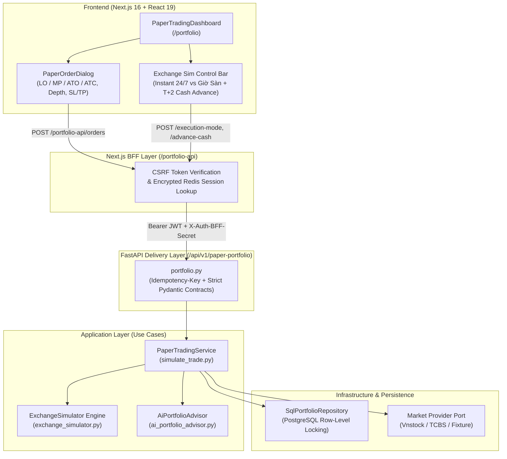
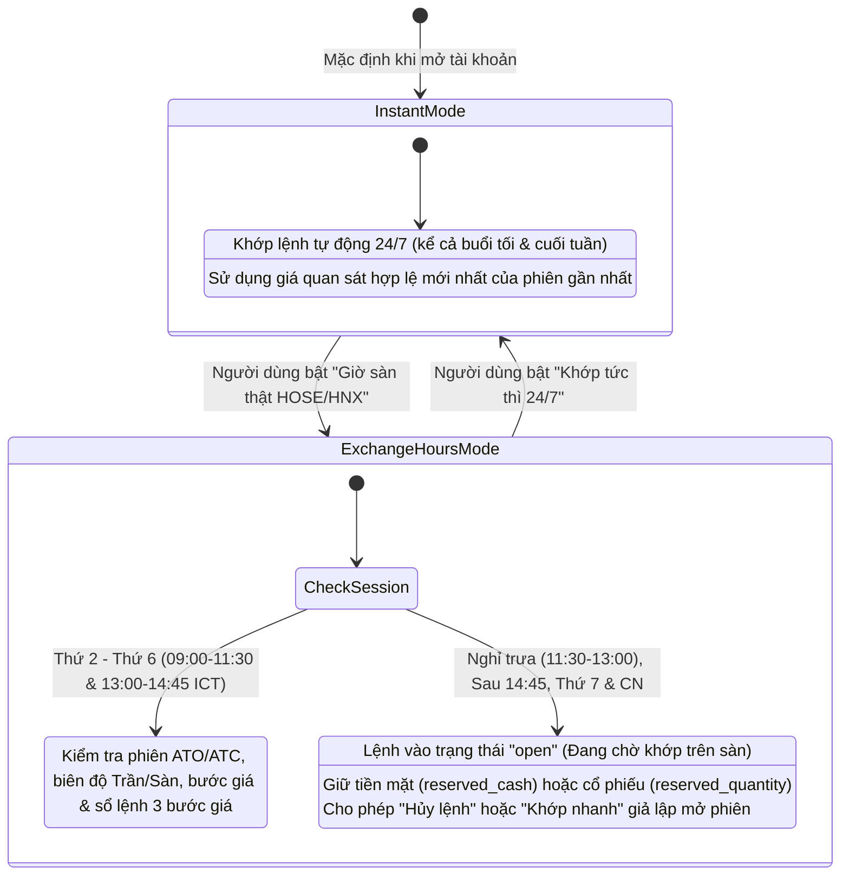
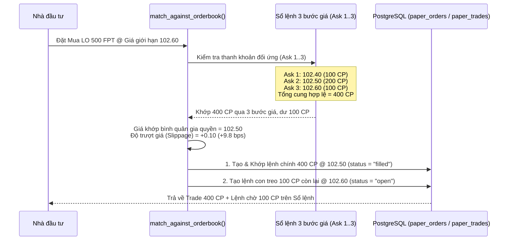

# Kiến Trúc & Luồng Hoạt Động Của Hệ Thống Giao Dịch Mô Phỏng (Paper Trading & Vietnam Stock Exchange Simulator)

Tài liệu này mô tả chi tiết kiến trúc kỹ thuật, quy tắc nghiệp vụ thị trường chứng khoán Việt Nam (`HOSE`, `HNX`, `UPCoM`, `VSDC`) và luồng hoạt động từ đầu đến cuối (End-to-End Workflow) của phân hệ **Giao dịch Mô phỏng (Paper Trading)** trên nền tảng **InvestIQ**.

---

## 1. Tổng Quan Kiến Trúc Phân Hệ Paper Trading

Phân hệ Paper Trading được thiết kế theo mô hình **Clean Architecture** kết hợp **Next.js BFF (Backend-for-Frontend)** để đảm bảo vừa an toàn bảo mật (chống giả mạo lệnh qua CSRF & Idempotency Key, khóa dòng dữ liệu `SELECT ... FOR UPDATE`), vừa mô phỏng sát thực tế cơ chế khớp lệnh của Sở Giao dịch Chứng khoán TP.HCM (`HOSE`), Sở Giao dịch Chứng khoán Hà Nội (`HNX`), thị trường `UPCoM` và Tổng công ty Lưu ký và Bù trừ Chứng khoán Việt Nam (`VSDC`).

### Sơ đồ Kiến trúc Tổng thể



### Danh mục các tệp mã nguồn cốt lõi

| Tầng kiến trúc | Đường dẫn tệp | Vai trò trách nhiệm |
| --- | --- | --- |
| **Domain Entities** | `backend/app/domain/entities/portfolio.py` | Định nghĩa thực thể bất biến `PaperPortfolio`, `PaperOrder`, `PaperTrade`. |
| **Domain Repository Port** | `backend/app/domain/repositories/i_portfolio_repository.py` | Hợp đồng giao tiếp cơ sở dữ liệu (`PaperOrderSubmission`, `PaperExecution`) và các ngoại lệ nghiệp vụ. |
| **Exchange Simulator Engine** | `backend/app/application/use_cases/portfolio/exchange_simulator.py` | Động cơ mô phỏng quy tắc sàn Việt Nam: Chế độ Kép (Option B), Chu kỳ `T+2` & Ứng trước tiền bán, Biên độ Trần/Sàn & Bước giá, Khớp độ sâu sổ lệnh 3 bước giá, Lệnh `LO`/`MP`/`ATO`/`ATC` + Quarantine `60s`, và Lệnh điều kiện `Stop-Loss`/`Take-Profit`. |
| **Paper Trading Use Case** | `backend/app/application/use_cases/portfolio/simulate_trade.py` | Điều phối đặt lệnh, làm mới sổ lệnh (`_refresh_orders`), định giá tài sản theo thời gian thực, tính toán đường cong vốn (`equity_curve`), bảng xếp hạng cộng đồng và cảnh báo rủi ro. |
| **API Schemas & Router** | `backend/app/schemas/portfolio.py`, `backend/app/api/v1/portfolio.py` | Kiểm duyệt hợp đồng dữ liệu đầu vào/đầu ra nghiêm ngặt (`extra="forbid"`) và cung cấp các RESTful endpoints bảo mật. |
| **SQL Repository** | `backend/app/infrastructure/db/repositories/sql_portfolio_repository.py` | Thực thi giao dịch ACID trên PostgreSQL (bảng `paper_portfolios`, `paper_holdings`, `paper_orders`, `paper_trades`). |
| **Frontend UI** | `frontend/src/components/portfolio/paper-trading-dashboard.tsx`, `paper-order-dialog.tsx` | Giao diện bảng giá nâng cao, sổ lệnh thời gian thực, thanh chuyển đổi chế độ sàn, quản lý `T+2` và phiếu đặt lệnh đa năng. |

---

## 2. Chế Độ Khớp Lệnh Kép — Dual Execution Mode (Phương Án B)

Nhằm giải quyết bài toán cân bằng giữa **trải nghiệm học tập mọi lúc (24/7)** của người mới bắt đầu và **tính kỷ luật khắt khe theo khung giờ sàn thật**, hệ thống triển khai **Phương án B (`ExecutionMode`)** cho phép người dùng chuyển đổi linh hoạt giữa 2 chế độ ngay trên thanh công cụ:



### So sánh chi tiết 2 chế độ

| Tiêu chí | Chế độ 1: Khớp tức thì 24/7 (`"instant"`) | Chế độ 2: Giờ sàn thật HOSE/HNX (`"exchange_hours"`) |
| --- | --- | --- |
| **Mục tiêu sử dụng** | Dành cho người mới học cách phân bổ vốn, trải nghiệm thử nghiệm vào buổi tối hoặc cuối tuần. | Dành cho nhà đầu tư rèn luyện kỷ luật đặt lệnh thực chiến giống hệt sàn chứng khoán Việt Nam. |
| **Khung giờ khớp lệnh** | Mọi thời điểm (`24/7`). | Chỉ khớp tự động trong giờ hành chính Thứ Hai – Thứ Sáu: **Sáng `09:00 – 11:30`**, **Chiều `13:00 – 14:45`** (múi giờ `Asia/Ho_Chi_Minh`) hoặc khi `provider.session == "open"`. |
| **Hành vi ngoài giờ giao dịch** | Tự động khớp ngay lập tức tại mức giá đóng cửa/quan sát hợp lệ gần nhất. | Lệnh được tiếp nhận vào sổ lệnh với trạng thái **`open` (Đang chờ khớp trên sàn)**, phong tỏa tiền mua (`reserved_cash`) hoặc cổ phiếu bán (`reserved_quantity`) chờ tới phiên kế tiếp. |
| **Thao tác trên lệnh đang chờ** | Không phát sinh lệnh treo. | Người dùng có thể bấm **Hủy lệnh** (hoàn lại ngay tiền/cổ phiếu khả dụng) hoặc bấm **Khớp nhanh** để giả lập tua nhanh tới phiên mở cửa. |

---

## 3. Năm Cải Tiến Mô Phỏng Sàn Chứng Khoán Việt Nam Đã Thực Thi

Bên cạnh Phương án B, hệ thống đã thực thi đồng bộ **5 cải tiến cốt lõi** để khắc phục độ trễ dữ liệu của nguồn `vnstock` và tái hiện đầy đủ cơ chế vi cấu trúc thị trường (`Market Microstructure`):

### 3.1. Cải tiến 1: Chu kỳ Thanh toán Bù trừ `T+2` Chuẩn VSDC & Ứng trước Tiền bán (`0.03%/ngày`)
- **Quy tắc chu kỳ `T+2` (`compute_t2_settlement_date`)**:
  - Mọi giao dịch Mua hoặc Bán khi khớp lệnh tại ngày `T+0` sẽ được tính toán thời điểm hoàn tất thanh toán bù trừ vào lúc **`13:00` chiều (giờ Việt Nam) của ngày làm việc thứ 2 (`T+2`)**, tự động bỏ qua Thứ Bảy và Chủ Nhật.
  - Ví dụ: Khớp lệnh vào sáng Thứ Năm $\rightarrow$ Cổ phiếu và tiền bán sẽ về tài khoản lúc `13:00` chiều Thứ Hai tuần kế tiếp.
- **Theo dõi minh bạch trên Dashboard (`build_t2_settlement_summary`)**:
  - `pending_buy_shares_by_symbol` & `pending_buy_settlements`: Danh sách cổ phiếu đã mua đang trên đường về tài khoản.
  - `receivable_cash_t2` & `pending_sell_settlements`: Tổng số tiền bán cổ phiếu đã khớp nhưng đang chờ VSDC thanh toán.
- **Nghiệp vụ Ứng trước tiền bán (`advance_sale_cash`)**:
  - Cho phép nhà đầu tư ứng trước toàn bộ hoặc một phần số tiền bán chờ về (`advanceable_cash`) thông qua endpoint `POST /api/v1/paper-portfolio/advance-cash` hoặc nút **Ứng trước tiền bán** trên giao diện.
  - Áp dụng mức phí ứng trước sát thực tế các công ty chứng khoán Việt Nam: **`0.03%/ngày`** (`ADVANCE_FEE_RATE_PER_DAY = 0.0003`).

### 3.2. Cải tiến 2: Biên độ Giá Trần – Sàn (`Price Band`), Bước Giá (`Tick Size`) & Phân loại Lô Chẵn/Lẻ (`Lot Size`)
Hàm `validate_vietnam_exchange_rules` kiểm tra nghiêm ngặt các quy định đặt lệnh của từng sàn:

1. **Biên độ Trần – Sàn (`calculate_price_band`)**:
   - Sàn **`HOSE` / `VN30`**: $\pm 7\%$ so với giá tham chiếu (`reference_price`).
   - Sàn **`HNX`**: $\pm 10\%$ so với giá tham chiếu.
   - Sàn **`UPCoM`**: $\pm 15\%$ so với giá tham chiếu.
   - Giá Trần được làm tròn xuống (`ROUND_FLOOR`) theo bước giá; Giá Sàn được làm tròn lên (`ROUND_CEILING`) theo bước giá. Mọi lệnh `LO` đặt ngoài khoảng `[Sàn, Trần]` đều bị từ chối với mã lỗi `PRICE_OUT_OF_BAND`.
2. **Bước giá quy định (`get_tick_size`)**:
   - Trên sàn **`HOSE`**:
     - Thị giá $< 10.000\text{ ₫}$: Bước giá **`10 ₫`**.
     - Thị giá từ $10.000\text{ ₫}$ đến $< 50.000\text{ ₫}$: Bước giá **`50 ₫`**.
     - Thị giá $\ge 50.000\text{ ₫}$: Bước giá **`100 ₫`**.
   - Trên sàn **`HNX` & `UPCoM`**: Bước giá đồng nhất **`100 ₫`**.
   - Nếu người dùng nhập giá lẻ không chia hết cho bước giá (ví dụ `28.530 ₫`), hệ thống từ chối với mã lỗi `INVALID_TICK_SIZE` và gợi ý ngay mức giá hợp lệ gần nhất (`28.500 ₫`).
3. **Quy tắc Lô chẵn (`Even Lot`) và Lô lẻ (`Odd Lot`) (`classify_lot_type`)**:
   - **Lô chẵn (`even`)**: Khối lượng là bội số của `100 CP` (`100`, `200`, `500`...).
   - **Lô lẻ (`odd`)**: Khối lượng từ `1` đến `99 CP` (chỉ được phép đặt bằng lệnh giới hạn `LO`; nếu dùng `MP`/`ATO`/`ATC` sẽ báo lỗi `ODD_LOT_ONLY_LO`).
   - **Lô hỗn hợp (`mixed`)**: Khối lượng $> 100$ nhưng không chia hết cho `100` (ví dụ `150 CP`) sẽ bị chặn trong chế độ nghiêm ngặt (`MIXED_LOT_NOT_ALLOWED`), yêu cầu tách thành 1 lệnh lô chẵn `100 CP` và 1 lệnh lô lẻ `50 CP` đúng chuẩn sàn.

### 3.3. Cải tiến 3: Khớp Lệnh Theo Độ Sâu Sổ Lệnh 3 Bước Giá (`Orderbook Depth`), Trượt Giá (`Slippage`) & Khớp Một Phần (`Partial Fill`)
Thay vì giả định thanh khoản vô hạn tại 1 mức giá duy nhất, hàm `match_against_orderbook` mô phỏng việc "quét" qua 3 bước giá dư mua/dư bán tốt nhất (`bid_levels` / `ask_levels` từ `MarketInstrument`):



- **Tính giá khớp bình quân gia quyền (`Weighted Average Execution Price`)**:
  $$\text{Giá khớp bình quân} = \frac{\sum_{i=1}^{k} (\text{Giá bước } i \times \text{Khối lượng khớp tại bước } i)}{\text{Tổng khối lượng khớp}}$$
- **Tính độ trượt giá (`slippage_vnd` và `slippage_bps`)**: Đo lường chênh lệch giữa giá khớp bình quân thực tế và giá chào đối ứng tốt nhất tại đỉnh sổ lệnh (`Best Bid` / `Best Ask`).
- **Xử lý Khớp một phần (`Partial Fill`) tương thích ràng buộc ACID**: Khi khối lượng đặt vượt quá tổng thanh khoản khả dụng tại các mức giá thỏa mãn giới hạn, phần khối lượng khớp được thực thi ngay thành `PaperTrade`, còn phần dư (`unfilled_quantity`) được tự động tách thành một lệnh chờ (`status = "open"`) giữ nguyên mức giá giới hạn trên sổ lệnh.

### 3.4. Cải tiến 4: Hỗ Trợ Đầy Đủ Các Loại Lệnh (`LO`, `MP`, `ATO`, `ATC`) & Cơ Chế Chống Nhìn Trước Tương Lai (`Anti-Lookahead Quarantine 60s`)
- **4 loại lệnh chuẩn sàn chứng khoán Việt Nam**:
  1. **`LO` (Limit Order – Lệnh giới hạn)**: Chỉ khớp tại mức giá chỉ định hoặc tốt hơn (Mua $\le$ giá đặt, Bán $\ge$ giá đặt). Nếu giá đặt chưa chạm giá đối ứng tốt nhất (`limit_price < Best Ask` khi Mua hoặc `limit_price > Best Bid` khi Bán), lệnh sẽ nằm chờ trên sổ lệnh (`status = "open"`).
  2. **`MP` (Market Price – Lệnh thị trường)**: Tự động quét thanh khoản đối ứng tốt nhất hiện có trên sổ lệnh để khớp ngay lập tức.
  3. **`ATO` (At The Opening – Lệnh khớp định kỳ mở cửa)**: Chỉ khớp trong khung giờ định kỳ mở cửa buổi sáng (`09:00 – 09:15`). Nếu đặt trước `09:00` hoặc ngoài khung giờ, lệnh được tiếp nhận vào hàng đợi chờ phiên `ATO`.
  4. **`ATC` (At The Closing – Lệnh khớp định kỳ đóng cửa)**: Chỉ khớp trong khung giờ định kỳ đóng cửa buổi chiều (`14:30 – 14:45`).
- **Cơ chế cách ly chống trục lợi độ trễ (`ANTI_LOOKAHEAD_QUARANTINE_SECONDS = 60`)**:
  - Do dữ liệu từ thư viện bên thứ ba (`vnstock`) có thể có độ trễ vài chục giây so với bảng điện thực tế, khi một lệnh `LO` đặt chờ ở mức giá thấp hơn thị trường trong chế độ nghiêm ngặt, hệ thống gắn mốc cách ly `quarantine_until = now + 60s`.
  - Lệnh phải tồn tại trên sổ lệnh tối thiểu `60 giây` trước khi được phép khớp tự động trong các chu kỳ làm mới (`_refresh_orders`), ngăn chặn triệt để hành vi nhìn giá thực tế từ bảng điện bên ngoài để đặt lệnh ăn chênh lệch trên nguồn giá trễ.

### 3.5. Cải tiến 5: Lệnh Điều Kiện Tự Động — Cắt Lỗ (`Stop-Loss`) & Chốt Lời (`Take-Profit`)
- Người dùng có thể thiết lập ngưỡng **Cắt lỗ tự động (`stop_loss_price`)** và/hoặc **Chốt lời tự động (`take_profit_price`)** ngay trong hộp thoại Mua cổ phiếu hoặc qua API `POST /api/v1/paper-portfolio/conditional-triggers`.
- Trong mỗi chu kỳ đồng bộ danh mục (`_refresh_orders`), hệ thống tự động đối chiếu thị giá hiện tại (`instrument.price`) của từng mã đang nắm giữ với các `ConditionalTriggerRecord` đang hoạt động (`status == "active"`):
  - Nếu $\text{Thị giá} \le \text{stop\_loss\_price}$: Tự động kích hoạt lệnh bán bảo vệ vốn, ghi nhận `PaperTrade` và lưu lý do kích hoạt (`"Kích hoạt Cắt lỗ tự động..."`).
  - Nếu $\text{Thị giá} \ge \text{take\_profit\_price}$: Tự động kích hoạt lệnh bán hiện thực hóa lợi nhuận (`"Kích hoạt Chốt lời tự động..."`).

---

## 4. Luồng Xử Lý Đặt Lệnh Chi Tiết (Order Lifecycle Flow)

```mermaid
flowchart TD
    Start(["Người dùng nhấn Xác nhận Mua/Bán"]) --> ValidateInput["1. Kiểm tra Pydantic Schema & Idempotency-Key"]
    ValidateInput --> FetchQuote["2. Lấy dữ liệu MarketInstrument & Giá quan sát"]
    FetchQuote --> CheckMode{"3. Kiểm tra ExecutionMode<br/>& Quy tắc Sàn"}

    CheckMode -->|Vi phạm Trần/Sàn, Bước giá, Lô hỗn hợp| Reject422["Trả về HTTP 422 PaperOrderError<br/>(Kèm gợi ý mức giá hợp lệ gần nhất)"]
    CheckMode -->|Hợp lệ| CheckSession{"4. Đang ở chế độ exchange_hours<br/>và ngoài giờ giao dịch?"}

    CheckSession -->|Đúng (Ngoài giờ / Cuối tuần / Chờ ATO-ATC)| QueueOrder["5A. Lưu lệnh vào PostgreSQL (status = 'open')<br/>Phong tỏa reserved_cash / reserved_quantity"]
    CheckSession -->|Sai (Instant 24/7 hoặc Trong phiên)| MatchBook["5B. Chạy match_against_orderbook()<br/>(Quét 3 bước giá Bid/Ask 1..3)"]

    MatchBook --> CanFill{"6. Có thể khớp ngay<br/>(can_fill_now == True)?"}
    CanFill -->|Không (Giá LO chưa chạm Best Ask/Bid)| Quarantine["Lưu lệnh chờ (status = 'open')<br/>Gắn quarantine_until = now + 60s"]
    CanFill -->|Có| ExecuteFill["7. Thực thi khớp lệnh (status = 'filled')<br/>Trừ phí môi giới 0.15% & thuế bán 0.10%<br/>Cập nhật giá vốn bình quân gia quyền"]

    ExecuteFill --> CheckPartial{"8. Khớp một phần<br/>(unfilled_quantity > 0)?"}
    CheckPartial -->|Có| CreateChild["Tạo thêm lệnh con (status = 'open')<br/>cho phần khối lượng dư chưa khớp"]
    CheckPartial -->|Không (Khớp toàn bộ)| RegisterSLTP["9. Đăng ký Conditional Trigger<br/>(Stop-Loss / Take-Profit nếu có)"]
    CreateChild --> RegisterSLTP

    QueueOrder --> ReturnResp(["10. Trả về PlacePaperOrderResponse<br/>+ Bản chụp Dashboard mới nhất"])
    Quarantine --> ReturnResp
    RegisterSLTP --> ReturnResp
```

---

## 5. Công Thức Tính Toán Tài Chính, Phí, Thuế & Định Giá Danh Mục

Tất cả các phép tính tiền tệ trong phân hệ Paper Trading đều sử dụng kiểu số học thập phân chính xác **`Decimal`** (tuyệt đối không dùng `float` để tránh sai số dấu phẩy động) và làm tròn đến đơn vị đồng (`round_vnd`):

1. **Vốn khởi tạo mặc định (`STARTING_CASH`)**: `100.000.000 ₫` (100 triệu đồng).
2. **Phí môi giới mô phỏng (`BROKER_FEE_RATE`)**: **`0,15%`** tính trên tổng giá trị giao dịch (`gross_amount`) cho cả chiều Mua và chiều Bán.
3. **Thuế thu nhập cá nhân khi Bán (`SELL_TAX_RATE`)**: **`0,10%`** tính trên tổng giá trị bán (chiều Mua không chịu thuế).
4. **Dòng tiền ròng (`cash_effect`)**:
   - Khi **Mua**: $\text{cash\_effect} = -(\text{gross\_amount} + \text{fee\_amount})$. Toàn bộ phí mua được cộng vào `total_cost_basis` để phản ánh đúng giá vốn hòa vốn thực tế.
   - Khi **Bán**: $\text{cash\_effect} = +(\text{gross\_amount} - \text{fee\_amount} - \text{tax\_amount})$.
5. **Lãi/Lỗ đã chốt (`realized_pnl`) khi Bán**:
   $$\text{realized\_pnl} = \text{cash\_effect}_{\text{bán}} - \left(\frac{\text{total\_cost\_basis}_{\text{hiện tại}}}{\text{quantity}_{\text{hiện tại}}} \times \text{quantity}_{\text{bán}}\right)$$
6. **Lãi/Lỗ chưa chốt (`unrealized_pnl`) của danh mục đang nắm giữ**:
   $$\text{unrealized\_pnl} = (\text{current\_price} \times \text{quantity}) - \text{total\_cost\_basis}$$

---

## 6. Hợp Đồng API (REST Endpoints)

Tất cả các endpoint dưới đây đều nằm dưới tiền tố `/api/v1/paper-portfolio` (được bọc qua BFF `/portfolio-api` với xác thực CSRF & HttpOnly Session):

| Phương thức | Endpoint | Mô tả chức năng |
| --- | --- | --- |
| `GET` | `/api/v1/paper-portfolio` | Làm mới sổ lệnh chờ, kiểm tra kích hoạt Stop-Loss/Take-Profit, định giá danh mục và trả về toàn bộ trạng thái tài khoản kèm khối `exchange_simulation`. |
| `POST` | `/api/v1/paper-portfolio/orders` | Đặt lệnh mua/bán mới (hỗ trợ `order_type`: `LO`, `MP`, `ATO`, `ATC`, `use_orderbook_depth`, `strict_rules`, `stop_loss_price`, `take_profit_price`). Yêu cầu header `Idempotency-Key`. |
| `DELETE` | `/api/v1/paper-portfolio/orders/{order_id}` | Hủy một lệnh đang chờ (`pending`/`open`) trên sổ lệnh và giải tỏa tiền/cổ phiếu phong tỏa. |
| `POST` | `/api/v1/paper-portfolio/orders/{order_id}/fill` | Khớp nhanh (Force-fill) một lệnh đang chờ trong chế độ `exchange_hours` để phục vụ học tập/thử nghiệm. |
| `POST` | `/api/v1/paper-portfolio/execution-mode` | Chuyển đổi qua lại giữa chế độ `"instant"` (Khớp tức thì 24/7) và `"exchange_hours"` (Giờ sàn thật HOSE/HNX). |
| `POST` | `/api/v1/paper-portfolio/advance-cash` | Ứng trước tiền bán chờ về `T+2` với mức phí `0.03%/ngày`. |
| `POST` | `/api/v1/paper-portfolio/conditional-triggers` | Thiết lập hoặc cập nhật ngưỡng Cắt lỗ (`Stop-Loss`) và Chốt lời (`Take-Profit`) tự động cho một mã cổ phiếu. |
| `DELETE` | `/api/v1/paper-portfolio/conditional-triggers/{trigger_id}` | Hủy một lệnh điều kiện `Stop-Loss` / `Take-Profit` đang hoạt động. |

---

## 7. Kiểm Chứng Chất Lượng (Unit, Integration, API & E2E Tests)

Toàn bộ luồng hoạt động của Paper Trading và bộ mô phỏng sàn chứng khoán Việt Nam được bảo vệ bởi hệ thống kiểm thử tự động đa tầng:

1. **Backend Unit Tests (`backend/tests/unit/portfolio/test_paper_trading_service.py`)**:
   - Kiểm thử chế độ mặc định `"instant"` khớp lệnh tự động 24/7.
   - Kiểm thử **Option B (`"exchange_hours"`)**: Đặt lệnh vào cuối tuần chuyển sang trạng thái chờ (`open`), giữ tiền đảm bảo (`reserved_cash`) và khớp lệnh khi vào phiên hoặc khi gọi `force_fill_order`.
   - Kiểm thử **Cải tiến 1 (`VSDC T+2 & Cash Advance`)**: Tính ngày `T+2` bỏ qua Thứ Bảy/Chủ Nhật, tổng hợp cổ phiếu chờ về, tiền bán chờ về và khấu trừ chính xác phí ứng trước `0.03%/ngày`.
   - Kiểm thử **Cải tiến 2 (`Price Band, Tick Size & Odd Lot`)**: Từ chối lệnh vượt biên độ Trần/Sàn, sai bước giá `10/50/100 ₫`, lô hỗn hợp `150 CP`, và lô lẻ dùng lệnh `MP`.
   - Kiểm thử **Cải tiến 3 (`3-Level Orderbook Depth & Partial Fill`)**: Quét 3 bước giá `Ask 1..3`, tính giá khớp bình quân gia quyền, độ trượt giá (`slippage_vnd`, `slippage_bps`) và tách phần dư chưa khớp thành lệnh chờ con.
   - Kiểm thử **Cải tiến 4 (`LO/MP/ATO/ATC & 60s Quarantine`)**: Khớp lệnh `MP`, treo lệnh `LO` giá thấp và chặn khớp sớm trong vòng `60 giây` cách ly chống nhìn trước tương lai.
   - Kiểm thử **Cải tiến 5 (`Stop-Loss & Take-Profit`)**: Tự động kích hoạt lệnh bán khi giá thị trường chạm ngưỡng cắt lỗ hoặc chốt lời.
2. **Backend API Integration Tests (`backend/tests/integration/api/test_paper_portfolio_api.py`)**:
   - Kiểm thử bảo mật BFF boundary, `Idempotency-Key`, và toàn bộ các endpoints `/orders`, `/execution-mode`, `/orders/{id}/fill`, `/advance-cash`, `/conditional-triggers`.
3. **Frontend Component & E2E Flow Tests (`frontend/src/components/portfolio/paper-trading-dashboard.test.tsx`)**:
   - Kiểm thử hiển thị bảng giá, kịch bản giả định P&L chưa chốt, đối chiếu P&L đã chốt, đặt lệnh có bảo vệ CSRF, chuyển đổi chế độ `Giờ sàn thật HOSE/HNX`, ứng trước tiền bán `T+2`, khớp nhanh lệnh chờ `ATO` và đặt lệnh `MP` kèm `Stop-Loss` / `Take-Profit`.

---

## 8. Quản Trị Hệ Thống & Kiểm Toán Lệnh Chờ (Admin Order Book & Audit Trail)

Để hỗ trợ đội ngũ vận hành hệ thống và giám sát thị trường, phân hệ Admin (`/admin/portfolios`) được trang bị tính năng quản trị danh mục và sổ lệnh của người dùng:

1. **Giám sát Sổ lệnh người dùng (User Order Book Monitoring)**:
   - Trong bảng chi tiết danh mục tài khoản người dùng, hiển thị đầy đủ danh sách các lệnh (`Sổ lệnh giao dịch của người dùng`) bao gồm: Mã lệnh, thời gian đặt, mã cổ phiếu, loại lệnh (`LO`, `MP`, `ATO`, `ATC`), chiều (`MUA`/`BÁN`), khối lượng, giá đặt, khối lượng đã khớp và trạng thái (`open`, `pending`, `filled`, `cancelled`, `expired`, `rejected`).
2. **Quyền hạn Hủy lệnh chờ của Admin (`Admin Cancel Order`)**:
   - **Quy chuẩn thực tế**: Tuân thủ chuẩn nghiệp vụ quản trị rủi ro và vận hành sàn giao dịch, Admin chỉ có quyền hủy các lệnh đang treo (`open`, `pending`) khi có sự cố kỹ thuật, lệnh vi phạm quy chế hoặc theo yêu cầu hỗ trợ người dùng.
   - **Thu hồi ký quỹ tức thì**: Thao tác hủy lệnh tự động cập nhật `status = 'cancelled'`, thiết lập `reserved_cash = 0` hoặc `reserved_quantity = 0` và giải phóng 100% số dư tiền mặt hoặc cổ phiếu đang bị đóng băng của người dùng.
   - **Ghi vết kiểm toán bắt buộc (`Admin Audit Logs`)**: Mọi thao tác hủy lệnh của Admin đều bắt buộc nhập lý do (tối thiểu 3 ký tự) và được ghi vết vào bảng `auth_audit_events` với `event_type = 'paper_order.cancelled_by_admin'`, lưu trữ danh tính Admin thực hiện, ID danh mục, ID lệnh, mã cổ phiếu, chiều, khối lượng, giá đặt và lý do can thiệp.
3. **Bảo đảm tính minh bạch (No Admin Force Fill)**:
   - Nghiệp vụ thực tế nghiêm cấm Admin can thiệp ép khớp lệnh (Force Fill) vào sổ lệnh của người dùng. Chức năng ép khớp chỉ tồn tại ở phía người dùng cá nhân trong chế độ học tập/thử nghiệm cục bộ (`/orders/{id}/fill`), không xuất hiện trong thẩm quyền quản trị của Admin nhằm bảo đảm tính khách quan và trung thực của dữ liệu thị trường.
